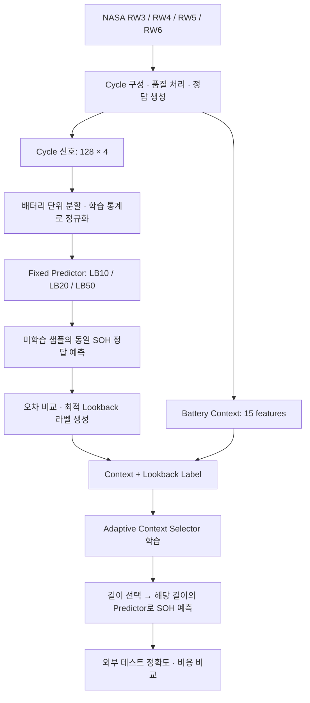

# Adaptive Temporal Context Selection for Battery SOH Estimation

코드는 역할별로 정리되어 있습니다. [scripts 파일 안내](scripts/README.md)에서 전체 파일 역할과 새 실행 명령을 확인할 수 있습니다. 실행은 프로젝트 최상위에서 `python -m scripts.<폴더>.<파일명>` 형식을 사용합니다.

**배터리의 운용 이력과 열화 상태에 따라 SOH 예측에 필요한 과거 정보의 길이를 선택하는 연구**입니다.

NASA Randomized Battery Usage Dataset을 사용해 `Lookback = 10 / 20 / 50`을 비교하고,
예측 시점까지 관측된 Battery Context로 적절한 길이를 선택하는 Adaptive Context Selector를 개발합니다.
현재는 **OOF 라벨 생성, Selector 학습·외부 셀 평가, Context와 과거 이력의 역할을 분리하는 후속 실험**까지 구현했습니다.
Adaptive 방식의 성능 개선 여부는 실험으로 검증할 연구 가설입니다.
후속 실험은 이전에 평가한 셀을 재사용한 탐색 실험이며, 독립 데이터에서의 확인이 필요합니다.

| 실행 단계 | 문서 | 로컬 출력 |
|---|---|---|
| Fixed Predictor와 OOF 라벨 생성 | [LOOKBACK_EXPERIMENT.md](LOOKBACK_EXPERIMENT.md) | `outputs/context_labels_v1/` |
| Selector 학습 및 외부 평가 | [ADAPTIVE_SELECTOR_EXPERIMENT.md](ADAPTIVE_SELECTOR_EXPERIMENT.md) | `outputs/adaptive_selector_v1/` |
| Context 변수 묶음 제거·Predictor 입력 비교 | [CONTEXT_HISTORY_EXPERIMENT.md](CONTEXT_HISTORY_EXPERIMENT.md) | `outputs/context_history_v1/` |
| 기존 Predictor 고정·오차 예측형 Selector 비교 | [ERROR_SELECTOR_EXPERIMENT.md](ERROR_SELECTOR_EXPERIMENT.md) | `outputs/error_selector_v1/` |
| 길이별 Context Ridge·두 Selector 비교 | [TEMPORAL_CONTEXT_REDESIGN.md](TEMPORAL_CONTEXT_REDESIGN.md) | `outputs/temporal_context_ridge_v1/` |
| Predictor 유지·재학습과 Selector 전이 비교 | [SELECTOR_TRANSFER_EXPERIMENT.md](SELECTOR_TRANSFER_EXPERIMENT.md) | `outputs/selector_transfer_v1/` |
| 추가 상온 자료 확보·전처리·최종 평가 셀 예약 | [DATA_EXPANSION.md](DATA_EXPANSION.md) | `data/processed/expanded_v1/` |
| 확장 데이터 품질 처리·개발 셀 Ridge 기준 성능 | [EXPANDED_BASELINE_EXPERIMENT.md](EXPANDED_BASELINE_EXPERIMENT.md) | `outputs/expanded_predictor_baseline_v1/` |
| 확장 데이터 Selector 학습·내부 보정 기준 비교 | [EXPANDED_SELECTOR_EXPERIMENT.md](EXPANDED_SELECTOR_EXPERIMENT.md) | `outputs/expanded_selector_v1/` |
| 운용 변화 Context·선형/비선형 Selector 비교 | [CHANGE_SELECTOR_EXPERIMENT.md](CHANGE_SELECTOR_EXPERIMENT.md) | `outputs/change_selector_v1/` |

### 길이별 Context Ridge 실험

[Temporal Context 재설계](TEMPORAL_CONTEXT_REDESIGN.md)는 기존 Context ridge의 통계 산출 범위를 10/20/50 cycles로 바꾸어 비교한 탐색 실험입니다.
고정 정보 6개 + 구간 통계 9개로 Predictor 입력을 15개로 맞추고, 고정된 짧은 Context로 길이를 선택하는 Selector를 평가합니다.
새 Predictor의 OOF 오차로 분류형·오차 예측형 Selector를 각각 학습하고, 고정 길이 방식과 비교했습니다. 실행 및 독립 검증을 완료했으며, 결과는 위 로컬 출력 폴더에 보관합니다.

GitHub에는 **코드와 실행 문서만** 포함합니다. 데이터·모델·결과·생성된 그림은 로컬에서 보관합니다.

## 1. 연구 배경

Fixed Lookback 방식은 검증 데이터에서 하나의 과거 구간 길이를 선택하고,
이후 모든 배터리와 예측 시점에 동일한 길이를 적용합니다.
그러나 배터리별 충·방전 패턴, 전류, 온도, 사용 이력과 열화 양상이 다르면
SOH를 예측할 때 유용한 과거 정보의 범위도 달라질 수 있습니다.

짧은 이력은 최근 상태를 반영하는 데 유리할 수 있고,
긴 이력은 장기적인 변화나 운용 패턴을 파악하는 데 도움이 될 수 있습니다.
어느 조건에서 어떤 길이가 유리한지는 배터리별·열화 단계별 비교로 확인합니다.

> **연구 가설:** SOH 예측에 유리한 temporal context의 길이는 배터리와 예측 시점에 따라
> 달라질 수 있으며, 관측 가능한 Battery Context를 이용해 이 길이를 선택할 수 있다.

## 2. Research Questions

| 질문 | 검증 내용 |
|---|---|
| **RQ1. 배터리마다 유리한 길이가 다른가?** | 동일 조건의 LB10·20·50 Predictor를 학습하고 배터리별 오차와 순위의 seed 안정성을 비교합니다. |
| **RQ2. 같은 배터리에서도 열화 단계에 따라 달라지는가?** | Early / Middle / Late 단계별 오차와 lookback 선택 분포를 분석합니다. |
| **RQ3. Battery Context로 길이를 선택할 수 있는가?** | 운용 이력에서 생성한 Context를 입력받아 LB10·20·50을 선택하는 selector를 학습합니다. |
| **RQ4. Adaptive Selection이 정확도와 효율성에 도움이 되는가?** | Fixed Lookback 대비 SOH 예측 오차, 평균 입력 길이, 실제 추론 비용을 비교합니다. |

여기서 **optimal lookback**은 지정한 후보·Predictor·학습 설정에서 관측된 오차가 가장 작은 길이입니다.
배터리에 필요한 정보 길이가 모델과 무관하게 결정된다는 의미는 아닙니다.

## 3. 전체 연구 흐름



| 단계 | 현재 상태 |
|---|---|
| 원본 데이터의 cycle 구성, 품질 처리, SOH 정답 생성 | 완료 |
| Predictor 입력과 selector용 Context 생성 | 완료 |
| 배터리 단위 분할 및 학습 전용 정규화 | 완료 |
| 동일 조건의 LB10·20·50 학습 및 미학습 샘플 예측 | 완료 |
| Seed별·배터리별·Stage별 내부 오차 집계와 선택 라벨 생성 | 완료 |
| Adaptive Context Selector 학습 및 Predictor 연결 | 첫 고정 설정 실험 완료 |
| 외부 테스트 성능, 계산 비용 비교 | 첫 평가 완료 |
| Context 변수 묶음 제거, 방전 정보·Context·순서 추세 추가 비교 | 탐색 실험 완료 |
| Context 기준선 대비 이력의 추가 효과, 데이터 확장·독립 검증 | 후속 연구 |

## 4. Dataset과 예측 문제

사용 데이터는 NASA Randomized Battery Usage Dataset 중
`Battery_Uniform_Distribution_Discharge_Room_Temp_DataSet_2Post`의
리튬이온 배터리 **RW3, RW4, RW5, RW6**입니다.
원본에는 시간, 전압, 전류, 온도, 충·방전 단계 설명과 기준 방전 기록이 포함됩니다.

### Cycle 입력

하나의 RW cycle은 여러 random-walk 방전 step과 그 사이의 짧은 휴지를 합친
**한 번의 완전한 RW 방전 구간**으로 정의합니다.
충전 신호와 방전 종료 후의 휴지는 입력에서 제외합니다.

- 전체 방전 구간을 시간축 기준 128점으로 선형 보간합니다.
- 채널은 `Voltage / Current / dV / Temperature`입니다.
- `dV`는 보간한 전압의 인접 차분이며 시간 미분 `dV/dt`가 아닙니다.
- 온도 범위 밖의 값을 결측으로 처리하고 관측 마스크를 보존합니다.
- 부적합 cycle의 위치를 유지하며, 해당 cycle이 최근 50회에 포함된 샘플은 제외합니다.
- 결측 대체와 정규화는 각 fold의 학습 데이터 통계만 사용합니다.

기준 SOH 측정 전에 완료된 cycle 수가 `n`일 때 입력은 다음과 같습니다.

| Lookback | 입력 구간 | 입력 형태 |
|---|---|---|
| LB10 | `x[n-10:n]` | `10 × 128 × 4` |
| LB20 | `x[n-20:n]` | `20 × 128 × 4` |
| LB50 | `x[n-50:n]` | `50 × 128 × 4` |

세 모델은 **동일한 샘플의 동일한 기준 SOH 측정값**을 예측합니다.
따라서 비교에 사용하는 샘플은 공통으로 유효한 50-cycle 이력을 가져야 합니다.

### SOH Ground Truth

기준 방전 전류를 적분해 용량을 계산하고, 각 배터리의 첫 유효 기준 용량으로 나눕니다.

$$
Q_k = \frac{1}{3600}\int I_k(t)\,dt,
\qquad
SOH_k = \frac{Q_k}{Q_0}
$$

주 평가에는 **실제로 측정한 기준 용량 기반 SOH**를 사용합니다.
동일 RW 이력 뒤 반복된 기준 측정은 첫 유효 측정만 사용합니다.
보간 SOH는 보조 라벨로 별도 저장하며 주 평가와 Context 입력에는 사용하지 않습니다.

모든 cycle에 실제 SOH 정답이 있는 것은 아닙니다.
또한 마지막 RW 방전과 이후 기준 측정 사이에 준비 충전·휴지·진단 시간이 존재하므로,
현재 문제는 **완료된 방전 이력으로 이후 기준 진단에서 측정한 SOH를 예측하는 설정**입니다.
테스트 배터리에도 초기 기준 용량 `Q0`가 제공된다고 가정합니다.

## 5. 데이터 분할과 Predictor 학습

배터리 하나를 외부 테스트로 제외한 뒤, 나머지 세 배터리 안에서
**학습 2개 / 라벨 생성 1개**를 번갈아 구성합니다.
예를 들어 외부 테스트가 RW6인 경우는 다음과 같습니다.

| 내부 실험 | Predictor 학습 | 미학습 예측·라벨 생성 | 외부 테스트 |
|---|---|---|---|
| A | RW4, RW5 | RW3 | RW6 |
| B | RW3, RW5 | RW4 | RW6 |
| C | RW3, RW4 | RW5 | RW6 |

외부 테스트 네 가지와 내부 라벨 생성 셀 세 가지를 조합해 총 12개 내부 fold를 사용합니다.
코드의 `validation` split은 이 단계에서 **OOF(out-of-fold) 예측과 라벨 생성용**으로 사용합니다.
이 배터리의 오차로 early stopping, epoch 또는 checkpoint를 선택하지 않습니다.
외부 테스트의 정답은 selector 학습 라벨에 사용하지 않습니다.

| 항목 | 설정 |
|---|---|
| Lookbacks | 10, 20, 50 cycles |
| Cycle encoder | `Flatten(128×4) → Linear(512,64) → ReLU → Linear(64,32) → ReLU` |
| Temporal aggregation | 과거 cycle embedding의 평균 |
| Prediction head | `Linear(32,32) → ReLU → Linear(32,1)` |
| 학습 방식 | LB별 독립 학습, 같은 seed에서 동일한 초기 가중치 |
| Loss / batch | MSE / full batch, 기준 측정 샘플별 동일 가중치 |
| Optimizer | Adam, learning rate `0.001` |
| 학습 길이 | 고정 200 epochs |
| Seeds | `42, 0, 1, 2, 3` |
| 실행 | CPU, deterministic algorithms |

200 epochs는 사전에 정한 시작 설정입니다.
후속 설정 탐색에서는 라벨 생성 대상 배터리를 모델 선택 과정에서도 제외해야 합니다.

## 6. Optimal Lookback 라벨 생성

학습에 포함되지 않은 샘플 `i`에 대해 lookback `L`, seed `s`별 절대오차를 계산합니다.

$$
e_{i,L,s} = |\hat y_{i,L,s} - y_i|
$$

대표 라벨은 **각 길이의 seed 평균 절대오차**가 가장 작은 후보로 정합니다.

$$
\bar e_{i,L} = \frac{1}{S}\sum_{s=1}^{S}e_{i,L,s},
\qquad
L_i^* = \underset{L\in\{10,20,50\}}{\arg\min}\;\bar e_{i,L}
$$

예측값을 먼저 seed 평균한 뒤 오차를 계산하는 앙상블 평가와는 계산 순서가 다릅니다.
정확한 동률이면 짧은 길이를 선택합니다.
대표 라벨과 함께 다음 정보를 보존합니다.

| 필드 | 의미 |
|---|---|
| `mean_error_lb10/20/50` | 후보별 seed 평균 절대오차 |
| `best_lookback` | 선택된 길이: 10 / 20 / 50 |
| `class_label` | 선택된 후보의 클래스: 0 / 1 / 2 |
| `error_gap_to_second_best` | 1위와 2위 후보의 평균 오차 차이 |
| `seed_agreement` | 대표 라벨과 seed별 최적 후보가 일치한 비율 |

외부 테스트별로 selector 학습 데이터셋을 따로 생성합니다.
각 데이터셋을 합쳐 공통 selector를 학습하면 제외해야 할 테스트 배터리 정보가 섞일 수 있습니다.

## 7. Battery Context와 Adaptive Selector

현재 Context는 **예측 입력의 마지막 cycle까지 관측된 운용 이력**에서 생성한 15개 변수입니다.

| 구분 | 변수 | 개수 |
|---|---|---:|
| 누적 운용 이력 | 완료된 cycle 수, 경과 시간, 누적 RW 방전량 | 3 |
| 최근 cycle | 방전 시간, 방전량, 온도 결측 비율 | 3 |
| 최근 10회 방전 시간 | 평균, 표준편차, 추세 | 3 |
| 최근 10회 전압 | 평균, 표준편차 | 2 |
| 최근 10회 전류 | 평균, 표준편차 | 2 |
| 최근 10회 온도 | 평균, 표준편차 | 2 |
| **합계** | | **15** |

Selector용 데이터에는 원본 Context와 결측 마스크를 저장합니다.
서로 다른 내부 fold의 정규화된 Context를 섞지 않고,
selector 학습 데이터에서 결측 대체와 정규화를 새로 수행하도록 구성했습니다.

실제 SOH, 보간 SOH, Stage, Battery ID, 미래 수명 및 예측 오차는 Context에 포함하지 않습니다.
SOH trend도 현재 입력에는 없으며, 후속 도입 시 추론 시점에 사용 가능한 과거 정보로 정의해야 합니다.

첫 Selector는 **15입력·3출력의 L2 규제 softmax 선형 분류 모델**입니다.
Context로 `P(LB10), P(LB20), P(LB50)`을 추정하고, 가장 높은 확률의 길이를 선택합니다.
외부 테스트를 제외한 3개 셀로 다시 학습한 Predictor 중 해당 길이의 모델 하나만 실행합니다.
Selector와 비교용 Context-only ridge 회귀의 L2는 각각 0.1로 사전 고정하며 튜닝하지 않았습니다.
Selector 학습용 OOF 라벨은 2개 셀로 학습한 Predictor에서 생성했으므로,
최종 3개 셀 학습 Predictor에도 같은 길이 선택이 유리한지는 외부 평가에서 확인합니다.

## 8. 평가 방법과 해석 범위

### 비교 대상

| 방법 | 평가 목적 |
|---|---|
| Fixed LB10 / LB20 / LB50 | 길이별 기본 예측 성능 |
| GlobalBestOOF | 학습 측 OOF 배터리별 MAE를 균등 평균해 고른 길이를 외부 테스트 전체에 적용 |
| LabelMajority | 학습 측에서 가장 흔한 Lookback 라벨을 모든 테스트 샘플에 적용 |
| Context-only SOH Predictor | Context만으로 직접 SOH를 예측할 때와 비교 |
| Adaptive Selector + Predictor | 샘플별 길이 선택의 효과 |
| Oracle | 정답을 알고 후보 중 최소 오차 예측을 선택한 사후 비교 기준 |

SOH 정확도는 MAE·RMSE로 평가하고, 배터리별 결과와 배터리에 동일 가중치를 주는 평균을 보고합니다.
효율성은 평균 선택 Lookback과 실제 추론 시간을 함께 측정합니다.
이번 시간 측정은 메모리에 준비된 리샘플링 신호·누적 메타데이터에서 시작하며,
Context 계산, 정규화, Selector, 선택한 Predictor 하나의 실행을 포함합니다.
파일 입출력, 원시 cycle 전처리, 모델 로딩, 최초 메타데이터 캐시 구축은 제외합니다.
CPU 1 thread, batch=1로 측정하며 원시 센서부터의 전체 운영 비용과 구분합니다.
입력 길이 감소가 실행 시간 감소와 비례한다고 가정하지 않습니다.
5개 seed의 표준편차는 초기값 변화이며 독립 배터리 모집단의 신뢰구간이 아닙니다.
각 실행에서는 설정을 고정하고 모든 학습을 마친 뒤 외부 셀을 평가하며, 해당 평가값으로 checkpoint를 선택하지 않습니다.
다만 이전 평가를 본 뒤 설계한 후속 실험은 탐색 결과로 구분하며, 새 독립 평가를 대신하지 않습니다.

### Stage 분석

| Stage | 실제 기준 SOH 구간 |
|---|---|
| Early | `SOH ≥ 0.9` |
| Middle | `0.8 ≤ SOH < 0.9` |
| Late | `SOH < 0.8` |

Stage는 정답을 이용한 사후 분석용 구분입니다.
단계별 표본 수와 seed별 순위 변화를 함께 확인하며, 미래 수명을 기준으로 구간을 나누지 않습니다.

### 해석 시 고려할 점

- 같은 기준 측정이 여러 외부 fold에 재사용되므로 라벨 행 수와 독립 측정 수를 구분합니다.
- 실제 기준 정답이 희소하고 같은 배터리의 인접 샘플은 독립적이지 않습니다.
- 후속 실험에 온도 변수 묶음 제외 비교를 포함했습니다. 개별 변수의 인과적 기여를 식별하는 실험은 아닙니다.
- 초기 Predictor의 평균 pooling은 cycle 순서를 구별하지 않습니다. 후속 실험은 선형 순서 추세를 추가하여 비교합니다.
- LB별 독립 학습 결과에는 입력 길이와 학습된 가중치의 영향이 함께 포함됩니다.
- 내부 OOF 오차와 Oracle 결과는 최종 외부 테스트 성능이나 Adaptive Selector의 성능을 의미하지 않습니다.

## 9. 실행 방법

### 환경과 데이터 준비

기준 실행 환경은 Python 3.9.6, NumPy 2.0.2, SciPy 1.13.1, PyTorch 2.8.0,
macOS arm64 CPU입니다. 패키지 버전은 [requirements-repro.txt](requirements-repro.txt)에 고정했습니다.

```bash
python3 -m venv .venv-repro
.venv-repro/bin/python -m pip install -r requirements-repro.txt

# Matplotlib 그림도 생성할 경우
.venv-repro/bin/python -m pip install -r requirements.txt
```

원본 MAT 파일을 다음 위치에 배치합니다.

```text
data/raw/
├── RW3.mat
├── RW4.mat
├── RW5.mat
└── RW6.mat
```

### 전처리부터 라벨 생성까지

프로젝트 루트에서 실행합니다.

```bash
# Cycle 전처리와 원본 대조 검증
.venv-repro/bin/python -m scripts.preprocessing.preprocess_main
.venv-repro/bin/python -m scripts.validation.verify_preprocessing

# 라벨 규칙 및 학습 재현성 단위 검증
.venv-repro/bin/python -m scripts.tests.test_lookback_oof

# Seed 42로 전체 흐름 실행
.venv-repro/bin/python -m scripts.experiments.train_lookback_oof --seeds 42
.venv-repro/bin/python -m scripts.validation.verify_lookback_oof

# 5개 seed로 확장: 동일 설정의 완료된 모델은 재사용
.venv-repro/bin/python -m scripts.experiments.train_lookback_oof --seeds 42 0 1 2 3
.venv-repro/bin/python -m scripts.validation.verify_lookback_oof
```

전처리는 `data/processed/main_v1/`, 학습·라벨 생성은 `outputs/context_labels_v1/`에 저장합니다.
코드·데이터·설정이 달라지면 `--output outputs/context_labels_v2`처럼 새 출력 경로를 사용합니다.
중단된 실행은 같은 명령으로 재개할 수 있습니다.
상세 프로토콜은 [LOOKBACK_EXPERIMENT.md](LOOKBACK_EXPERIMENT.md)를 참조하세요.

### Selector 학습과 외부 배터리 평가

5개 seed의 OOF 라벨 생성과 검증을 먼저 완료해야 합니다.

```bash
.venv-repro/bin/python -m scripts.tests.test_adaptive_selector
.venv-repro/bin/python -m scripts.experiments.train_adaptive_selector --phase fit
.venv-repro/bin/python -m scripts.experiments.train_adaptive_selector --phase evaluate
.venv-repro/bin/python -m scripts.validation.verify_adaptive_selector
```

출력은 로컬 `outputs/adaptive_selector_v1/`에 저장합니다.
상세 설정과 비교 기준은 [ADAPTIVE_SELECTOR_EXPERIMENT.md](ADAPTIVE_SELECTOR_EXPERIMENT.md)에 있습니다.

### Context / 과거 이력 후속 실험

외부 평가 결과가 생성된 다음 실행합니다. 설정·코드·데이터 해시가 다르면 별도 출력 경로를 사용합니다.

```bash
.venv-repro/bin/python -m scripts.tests.test_context_history
.venv-repro/bin/python -m scripts.experiments.train_context_history
.venv-repro/bin/python -m scripts.validation.verify_context_history

# Matplotlib 설치 후, 검증된 결과로 그림과 보고서 생성
.venv-repro/bin/python -m scripts.plotting.plot_adaptive_results
.venv-repro/bin/python -m scripts.plotting.plot_soh_predictions
.venv-repro/bin/python -m scripts.plotting.plot_context_history
```

실험 설정은 [CONTEXT_HISTORY_EXPERIMENT.md](CONTEXT_HISTORY_EXPERIMENT.md)에 정의합니다.
결과는 로컬 `outputs/context_history_v1/REPORT.md`, 그림은 각 출력 폴더의 `figures/`에 생성합니다.

## 10. 저장소 구성

| 파일 | 역할 |
|---|---|
| [scripts/preprocessing/preprocess_main.py](scripts/preprocessing/preprocess_main.py) | Cycle 구성, 정답·Context 생성, 분할·정규화 |
| [scripts/preprocessing/battery_data.py](scripts/preprocessing/battery_data.py) | 동일 샘플의 LB10·20·50 입력 로더 |
| [scripts/experiments/train_lookback_oof.py](scripts/experiments/train_lookback_oof.py) | Predictor 학습, OOF 예측, 라벨 생성 |
| [scripts/validation/verify_preprocessing.py](scripts/validation/verify_preprocessing.py) | 원본·전처리·분할 검증 |
| [scripts/validation/verify_lookback_oof.py](scripts/validation/verify_lookback_oof.py) | 모델·예측·라벨·Context 검증 |
| [scripts/tests/test_lookback_oof.py](scripts/tests/test_lookback_oof.py) | 라벨 계산 및 학습 재현성 단위 검증 |
| [scripts/models/adaptive_models.py](scripts/models/adaptive_models.py) | Context 계산, Selector/ridge 학습, 선택한 Predictor 추론 |
| [scripts/experiments/train_adaptive_selector.py](scripts/experiments/train_adaptive_selector.py) | 고정 설정 학습, 외부 배터리 평가, 정확도·시간 집계 |
| [scripts/validation/verify_adaptive_selector.py](scripts/validation/verify_adaptive_selector.py) | 학습 전용 통계·저장 모델 예측·지표 독립 재검증 |
| [scripts/tests/test_adaptive_selector.py](scripts/tests/test_adaptive_selector.py) | 미래 정보 차단·분류 기울기·모델 선택 경로 검증 |
| [scripts/models/context_history_models.py](scripts/models/context_history_models.py) | Context 변수 묶음과 동일 크기 Predictor의 입력 추가 비교 |
| [scripts/experiments/train_context_history.py](scripts/experiments/train_context_history.py) | 고정 설정의 Context·과거 이력 탐색 실험 |
| [scripts/validation/verify_context_history.py](scripts/validation/verify_context_history.py) | 학습 전용 통계, 저장 모델, 예측·지표 검증 |
| [scripts/tests/test_context_history.py](scripts/tests/test_context_history.py) | 입력 차단·순서 표현·미래 정보 차단 검사 |
| `scripts/plotting/plot_*.py` | 검증된 결과를 Matplotlib 그림으로 생성 |
| [figures/soh_adaptive_framework_v3/](figures/soh_adaptive_framework_v3/) | 연결형 제안 구조도의 최신 생성 코드와 설명 |

현재 연구는 **코드와 실행 문서만 공개**합니다.
원본·전처리 데이터, Context, 예측값, 선택 라벨, 결과 보고서 및 모델 가중치는 로컬에서 생성하며 Git에서 제외합니다.

현재 저장소의 실행 기준은 **cycle 단위·측정 SOH 목표** 파이프라인입니다.
이전 step 단위 예비 코드, 중간 그림 버전과 예비 출력은 현재 작업 구조에서 제거했습니다.
사용하지 않는 예비 자료는 삭제했습니다. `.local_archive/script_layout_20261111/scripts/`에는 과거 실험의 코드 해시 검증에 필요한 폴더 이동 전 원본만 로컬 보관합니다.

- `scripts/`: 현재 연구의 전처리·학습·검증·그림 코드.
- `figures/soh_adaptive_framework_v3/`: 제안 구조도 생성 코드. 생성된 draw.io/SVG/PNG/PDF 파일은 Git에서 제외.
- `data/`: 사용자가 준비한 원본과 생성된 전처리 데이터. Git에서 제외.
- `outputs/`: 실험별 모델·예측·라벨·보고서·그림. 성능과 무관하게 연구 기록을 보존하며 Git에서 제외.
- `.local_archive/`: 과거 실험의 코드 해시 검증에 필요한 이동 전 소스. Git에서 제외.

학습 코드와 실험 폴더의 `protocol.json`은 재현을 위한 해시로 연결되어 있습니다.
완료된 실험의 모델 코드를 변경할 때는 새 실험 버전과 출력 경로를 사용합니다.
예전에 커밋된 파일을 현재 저장소에서 제거해도 과거 Git 커밋에는 남습니다.

## Reference

데이터셋 사용 시 원본 설명에서 요청한 다음 논문을 인용합니다.

Brian Bole, Chetan Kulkarni, and Matthew Daigle.
*Adaptation of an Electrochemistry-based Li-Ion Battery Model to Account for Deterioration Observed Under Randomized Use.*
Annual Conference of the Prognostics and Health Management Society, 2014.
